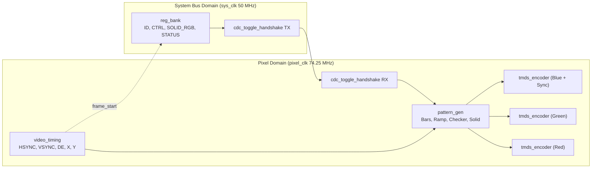
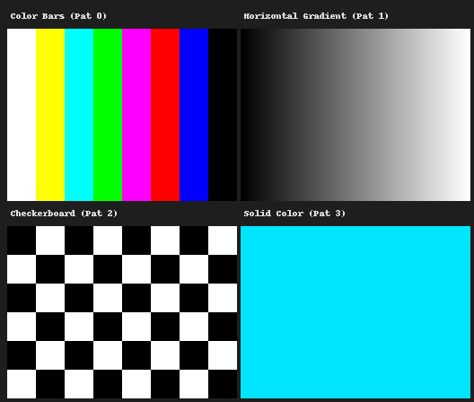

# TMDS Video Test-Pattern Generator & CDC Register Bank

Synthesizable SystemVerilog raster video generator and standard DVI 1.0 TMDS encoder with multi-clock CDC register control (720p60 standard geometry & 64x48 fast simulation preset).



## Clock Domains & CDC Architecture
- **Clock Domains**: `sys_clk` (50 MHz MMIO configuration) and `pixel_clk` (74.25 MHz video raster generation) operate asynchronously.
- **CDC Mechanism**: 27-bit config bus `{pattern_sel[1:0], enable, solid_rgb[23:0]}` is transferred using `cdc_toggle_handshake`. Data is held static on the source while a toggle flag crosses a 2-flop synchronizer. Destination latches data only upon edge detection, preventing physical skew and multi-bit mixed-value corruption. Back-synchronized pulse edge detection safely imports the frame counter into `STATUS`.

## Video Timing & Register Map
| Parameter | 720p60 (Default) | Fast Sim Preset | Register Address | Name | Description |
| :--- | :--- | :--- | :--- | :--- | :--- |
| Active (H x V) | 1280 x 720 | 64 x 48 | `0x0` | `ID` | Read-only hardware signature (`0x544D4453` = "TMDS") |
| Front Porch (H / V) | 110 / 5 | 6 / 2 | `0x4` | `CTRL` | `[1:0]` Pattern (0:Bars, 1:Grad, 2:Check, 3:Solid), `[2]` Enable |
| Sync Width (H / V) | 40 / 5 | 6 / 4 | `0x8` | `SOLID_RGB` | `[23:0]` Solid RGB color code (e.g. `0x00E5FF`) |
| Back Porch (H / V) | 220 / 20 | 8 / 6 | `0xC` | `STATUS` | `[15:0]` Synchronized frame count, `[31]` CDC busy/pending flag |
| Total (H x V) | 1650 x 750 | 84 x 60 | | | |

## Verification Suite
| Testbench / Script | Scope & Assertions | Proves |
| :--- | :--- | :--- |
| `tb_video_timing` | 311 automated checks on DUT outputs (64x48 & full 720p60 for 1.23M cycles) | Pixel-accurate raster timing, porches, line/frame periods |
| `tb_tmds_encoder` | 10,580 checks: 256 exhaustive values, 10,000 random pixels, control tokens | Lossless decode invertibility, DC balancing, running disparity $\in [-8, +8]$ |
| `tb_top` | 14 checks: MMIO bus, 4 patterns x 2 frames, back-to-back coalescing, atomic CDC monitor | Glitch-free clock domain crossing, register control, update coalescing, frame sync |
| `frame_to_png.py` | Vectorized NumPy golden model against decoded simulation PPM frames | 100% pixel-perfect match (0 mismatches across 12,288 pixels) |



## Quickstart (3 Commands)
```bash
make clean
make all       # Compiles and runs all 3 SV testbenches + Python golden verification
ls -la out/    # Inspect generated PPM frames, 10-bit hex symbols, and montage.png
```

## Assumptions, Limitations & Future Work
- **Assumptions**: Active-low asynchronous reset with synchronous deassertion per domain; DVI 1.0 RGB 4:4:4 parallel 10-bit symbols.
- **Limitations**: Stop at parallel 10-bit TMDS words (no vendor serializer primitive); multi-register writes issued while CDC is busy coalesce via a pending flag into a single transfer of the latest register state, observable via `STATUS[31]`.
- **Future Work**: Target FPGA physical bring-up with Xilinx `OSERDESE2` / `selectio` 10:1 DDR serializer and `TMDS_33` buffers; HDMI 1.4a audio clock regeneration and Data Island packet formatting; 1080p60 timing closure.

## Quantified Resume Bullets
- Engineered a synthesizable DVI TMDS video pipeline in SystemVerilog, architecting a glitch-free toggle CDC handshake and verifying 0 mixed-value corruptions across asynchronous 50 MHz and 74.25 MHz clock domains.
- Built self-checking SystemVerilog testbenches in Icarus Verilog executing 10,905 automated assertions, proving exact DVI 1.0 transition minimization, DC balance boundedness ($\pm 8$), and raster timing across 1.23M simulated cycles.
- Developed an end-to-end automated regression workflow with a vectorized NumPy golden reference model, achieving 100% bit-exact image reconstruction (0 mismatches across 12,288 pixels) and generating verified multi-pattern visual montages.
